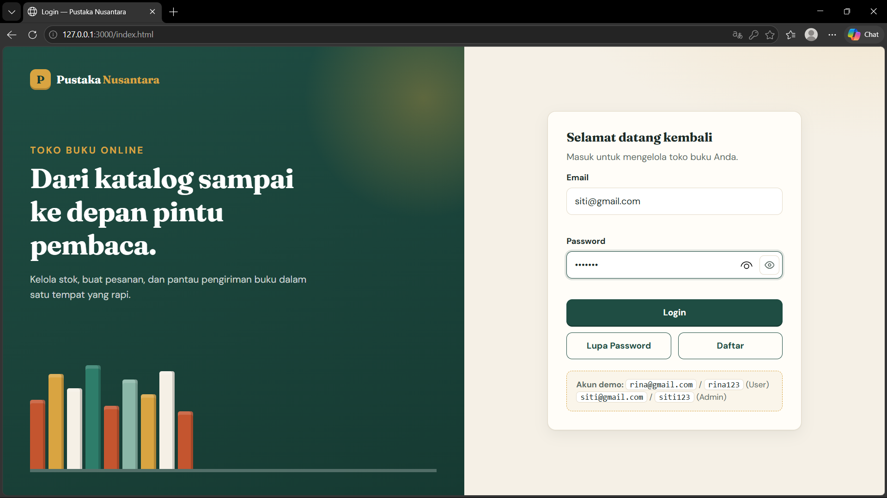
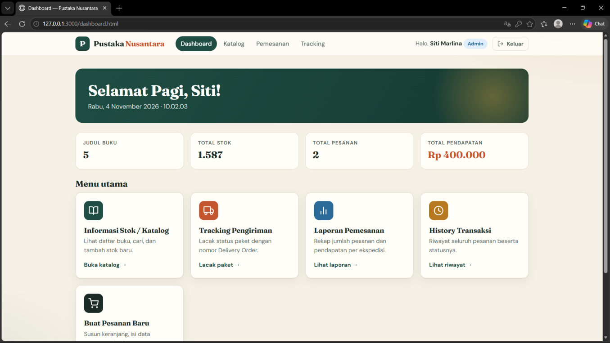
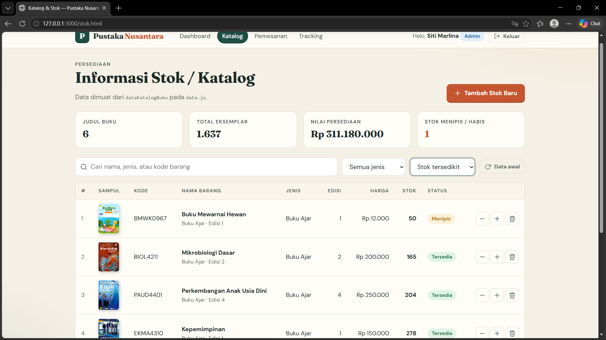
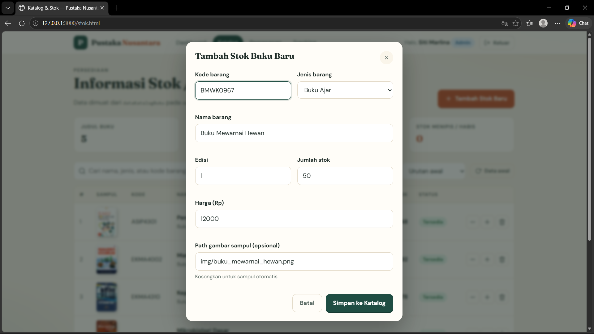
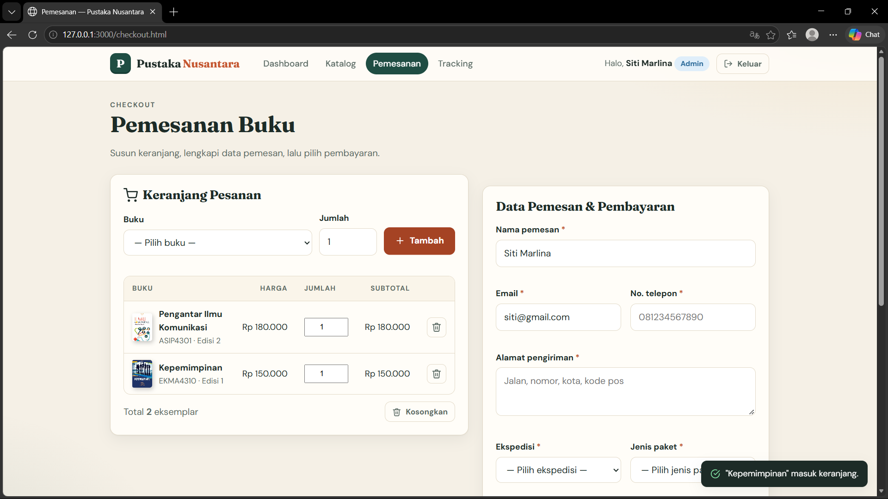
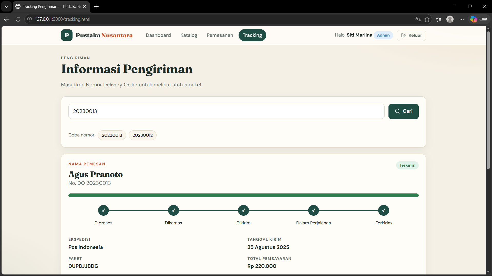

### Aplikasi Pemesanan Buku Online
> Project Ujian Tengah Semester (UTS) — Pemrograman Web 1

-------------------------------------------------
### DATA DIRI
Nama    Raihan Nabil Mas'ud
NIM     312510094
Kelas   I.25.1A


### 1. Deskripsi Project
Aplikasi Pemesanan Buku Online merupakan aplikasi web sederhana yang dirancang untuk mensimulasikan proses pemesanan buku pada sebuah toko online. Project ini berfokus pada pengembangan sisi front-end menggunakan HTML, CSS, dan JavaScript.
Data aplikasi menggunakan data dummy yang disimpan dalam file JavaScript terpisah dalam bentuk array/object, sehingga aplikasi tidak memerlukan server atau database.
Aplikasi ini dibuat untuk menerapkan struktur HTML semantik, pengaturan tampilan menggunakan CSS, manipulasi DOM, validasi formulir, serta interaksi antarmuka pengguna.

### 2. Tujuan Project
Menerapkan struktur HTML yang semantik dan valid.
Mengatur tampilan halaman menggunakan CSS.
Menggunakan JavaScript untuk manipulasi DOM dan data.
Menerapkan validasi formulir serta memberikan feedback kepada pengguna.
Membuat halaman-halaman yang saling terhubung melalui navigasi.

### 3. Fitur dan Halaman Aplikasi
Berikut halaman yang menjadi ruang lingkup project sesuai instruksi tugas:

### 3.1 Halaman Login (`login.html`)
Halaman login digunakan sebagai tampilan awal untuk masuk ke aplikasi.
Fitur yang direncanakan sesuai spesifikasi tugas:
- Input email dan password.
- Tombol Login.
- Peringatan apabila email atau password tidak sesuai.
- Tombol Lupa Password dan Daftar yang menampilkan modal atau pop-up.

## Screenshot:
Simpan tangkapan layar halaman login di `screenshots/login.png`, lalu tampilkan di bawah ini.


### 3.2 Dashboard (`dashboard.html`)
Dashboard merupakan halaman menu utama setelah pengguna masuk ke aplikasi.
Menu yang diminta dalam tugas:
- Informasi Stok/Katalog.
- Tracking Pengiriman.
- Laporan Pemesanan.
- History Transaksi.
- Dashboard juga menampilkan greeting berdasarkan waktu lokal, seperti pagi, siang, atau sore.

## Screenshot:


### 3.3 Informasi Stok/Katalog (`stok.html`)
Halaman ini menampilkan daftar buku berdasarkan data dummy pada variabel `dataKatalogBuku` di file JavaScript.
Fitur yang diminta dalam tugas:
- Menampilkan data katalog secara dinamis.
- Menambahkan baris atau data stok baru menggunakan JavaScript DOM.

## Screenshot:


## Screenshot proses penambahan stok:


### 3.4 Halaman Pemesanan / Checkout (`checkout.html`)
Halaman checkout digunakan untuk menampilkan dan mengelola data pemesanan buku.
Fitur yang diminta dalam tugas:
- Menampilkan data pemesanan.
- Menambahkan atau mengubah data pemesanan.
- Mengisi informasi pemesan dan pembayaran.

## Screenshot:


### 3.5 Informasi Pengiriman (`tracking.html`)
Halaman tracking digunakan untuk mencari informasi pengiriman berdasarkan nomor Delivery Order (DO).
Setelah nomor DO dicari, informasi yang ditampilkan sesuai spesifikasi tugas meliputi:
- Nama pemesan.
- Status pengiriman.
- Detail ekspedisi.
- Tanggal pengiriman.
- Jenis paket.
- Total pembayaran.
- Status pengiriman dapat disajikan menggunakan progress bar, warna, tabel, atau daftar.

## Screenshot:


### 4. Teknologi yang Digunakan
- HTML > **Membuat struktur dan elemen halaman web.**
- CSS > **Mengatur desain, tata letak, dan tampilan aplikasi.**
- JavaScript > **Mengelola data dummy, validasi, interaksi, dan manipulasi DOM.**

### 5. Struktur Folder
Contoh struktur dokumentasi project (sesuaikan dengan struktur repository yang sebenarnya):
```text
project-pemesanan-buku/
├── login.html
├── dashboard.html
├── stok.html
├── checkout.html
├── tracking.html
├── css/
│   └── style.css
├── js/
│   ├── data.js
│   └── script.js
├── assets/
│   └── ...
├── screenshots/
│   ├── login.png
│   ├── dashboard.png
│   ├── stok.png
│   ├── tambah-stok.png
│   ├── checkout.png
│   └── tracking.png
└── README.md
```

### 6. Cara Menjalankan Project
Unduh atau clone repository ini.
Ekstrak project apabila diunduh dalam bentuk ZIP.
Buka folder project menggunakan Visual Studio Code atau editor kode lainnya.
Jalankan file `login.html` melalui browser. Jika menggunakan ekstensi Live Server, klik kanan file HTML lalu pilih Open with Live Server.
Gunakan navigasi pada aplikasi untuk membuka halaman dan mencoba fitur yang tersedia.

### 7. Dokumentasi Video
Video berisi penjelasan mengenai sistematika pembuatan, alur penggunaan, fitur aplikasi, serta penerapan HTML, CSS, dan JavaScript.
Link YouTube:  
Masukkan link video demonstrasi YouTube di sini
> Ganti tautan di atas dengan URL video YouTube project yang sebenarnya.

### 8. Dokumentasi Screenshot
Letakkan seluruh tangkapan layar pada folder `screenshots/` di repository. Pastikan:
Screenshot berasal dari aplikasi yang benar-benar dijalankan.
Gambar memperlihatkan halaman atau proses yang sedang dijelaskan.
Nama file gambar sesuai dengan tautan gambar di README.
Screenshot tidak tertinggal atau belum diunggah ketika repository dikumpulkan.

### 9. Informasi Project
Keterangan	Informasi
Nama Project	Aplikasi Pemesanan Buku Online
Mata Kuliah	Pemrograman Web 1
Jenis Tugas	Ujian Tengah Semester (UTS)
Pengembangan	Front-end
Bahasa	HTML, CSS, JavaScript
Sumber Data	Data dummy JavaScript
---
